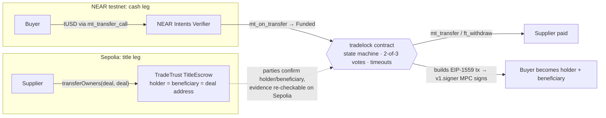
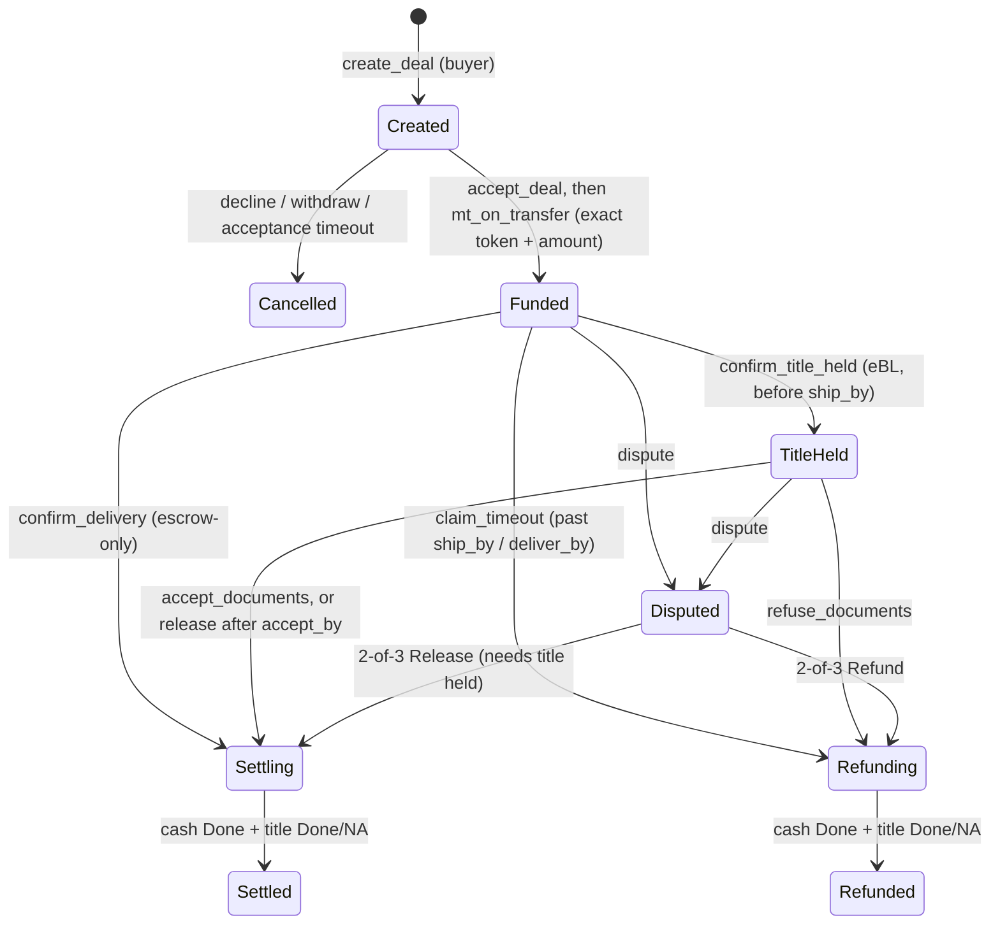

# Tradelock

**The buyer only gets the goods when the seller gets paid — and no bank is needed.**

Tradelock is **documents-against-payment (D/P) for cross-border trade, with no bank**. One NEAR smart contract holds both sides of a trade:

- **Cash leg:** the buyer's stablecoins, held as the contract's balance in a **NEAR Intents** Verifier.
- **Title leg:** the supplier's **electronic bill of lading** (a TradeTrust eBL, the legal document of title to the cargo). It sits on Sepolia at an EVM address that **only this contract can sign for**, through **NEAR Chain Signatures (MPC)**.

When the buyer accepts the documents, the contract pays the supplier. It also builds the title-transfer transaction itself and has the NEAR MPC network sign it over to the buyer. If the deal fails, both legs go back to where they came from.

> **Status:** live on **NEAR testnet + Sepolia** (no mainnet deployment). **5 deals completed on-chain**: settled, refunded, escrow-only, settled 2-of-3 after a dispute, and a settlement recorded for the demo video. All their transactions are linked below. **116 Rust tests + 35 TypeScript tests** pass, including sandbox E2E tests against the real nearcore runtime and the real NEAR Intents Verifier code. Built at NEAR HACKATHON, track **Real-World Money**.

---

## For evaluators: verify in 2 minutes

| Claim | How to check it |
|---|---|
| A NEAR contract moved legal title to goods on another chain | Deal 0: [MPC signature request on NEAR](https://testnet.nearblocks.io/txns/DZFWBvA2zQAfdZUZXKGMjPSdbQGAUMfGR67nVUcBi9LR) → [title transfer on Sepolia](https://sepolia.etherscan.io/tx/0x5ad29edf7e351452e394a8cba8e3f67f03f3fe445650ff0fda8ef9804f58fb09), sent from the deal's MPC-derived address `0xdDa5…cA4c`. No private key exists for that address |
| Cash and title were released together | Deal 0: the same [`accept_documents`](https://testnet.nearblocks.io/txns/5FxqswApG284GyQusQUGxC1gxwrUez2b5XV7apBBDWo4) call paid the supplier and started the title leg |
| The title is really with the buyer now | `cast call 0x15149d3f55801f7A112A595520De234d8821DA76 "holder()(address)" --rpc-url https://ethereum-sepolia-rpc.publicnode.com` → buyer `0x6a7d…46ed` |
| Disputes resolve 2-of-3 | Deal 3: votes [Refund](https://testnet.nearblocks.io/txns/E4t2vFYyucMA4iUNTGGzZb1gQ6bZphm6yXcryMmRQoas) / [Release](https://testnet.nearblocks.io/txns/CXQTjEZwhVg3wmyDZSC2v4BgAVHfGkaVDXDArqHwZFYt) / [Release](https://testnet.nearblocks.io/txns/Gsk6o7KCVR1WbKa5CEhtVHggMPFgU6pxYBK95zKR6uvc) → [title to buyer](https://sepolia.etherscan.io/tx/0x412a20399ace6763ff4007dadc5baddf548b81796fcea0e418a1efcf97f99b3d) |
| The engineering holds up | `pnpm install && pnpm test` (no keys needed); `pnpm contracts:build && pnpm contracts:test` |
| The deployed code is this code | `tradelock.wasm` sha256 `e747afe8…` = on-chain code hash `GZpaZb3b…` ([`docs/DEPLOYMENTS.md`](docs/DEPLOYMENTS.md)) |

---

## The problem

- **Cross-border trade has a first-mover problem.** Suppliers won't ship before they are paid. Buyers won't pay before they control the goods.
- **Banks solve it with documents against payment (D/P)** and letters of credit: the bank holds the bill of lading, the title to the cargo, until the buyer pays. This is slow and costly. About **41% of SME trade-finance applications are rejected** (Asian Development Bank), within a **~$2.5T global trade-finance gap**.
- **Without a bank, small traders have bad options.** They prepay and hope, or send a final, public stablecoin payment with nothing tied to it.
- **The title is already digital.** Electronic bills of lading are legal title in MLETR jurisdictions (UK Electronic Trade Documents Act 2023, Singapore, Bahrain, France and others). TradeTrust (Singapore IMDA's open framework) already represents eBLs as tokens on Ethereum-family chains. But exchanging that title for payment still goes through a bank.

### Why existing approaches fall short

| | Bank D/P | Prepayment | On-chain stablecoin escrow | **Tradelock** |
|---|---|---|---|---|
| Needs a bank | yes | no | no | **no** |
| Who holds the title until payment | collecting bank | nobody (goods already shipped) | nobody: escrow covers cash only | **the deal's MPC-controlled address** |
| Buyer protected if the supplier never ships | yes | no | yes | **yes** (`ship_by` refund) |
| Supplier protected if the buyer stalls | yes | yes | depends on a delivery confirmation | **yes**: cash is locked before title moves; after the acceptance window anyone can `release` |
| Title stays in its issuing registry | yes | — | — | **yes**: no bridge, no wrapped token. The eBL never leaves TradeTrust's own TitleEscrow |

## What Tradelock does

1. **Create and fund.** The buyer proposes terms; the supplier accepts; the buyer funds the deal from their NEAR Intents balance (`mt_transfer_call`). The contract accepts only the exact token and amount and refunds anything else.
2. **Hand over the title.** The supplier transfers the eBL's holder and beneficiary roles to **the deal's own Sepolia address**. The MPC network derives this address from the contract account and the path `tradelock/deal/{id}`. It has no private key; only the contract can sign for it.
3. **Confirm the title is held.** The buyer reads the TitleEscrow on Sepolia and confirms. The deal is now holding both assets, and the document-acceptance window starts.
4. **Accept or refuse the documents.**
   - **Accept:** the contract pays the supplier and signs the title over to the buyer, who collects the cargo with it.
   - **Refuse** (within the window): cash goes back to the buyer and title back to the supplier.
   - **Silence past the window:** anyone can `release`, exactly as in bank D/P.
5. **Disputes** are decided 2-of-3 by buyer, supplier and arbiter. Trades without an eBL run in **escrow-only mode**: cash only, released when the buyer confirms delivery.



---

## What is novel

**A NEAR contract holds legally recognised title to physical goods on another chain, and releases it under its own rules, in the same deal that holds the payment.**

- **No bridge, no wrapped asset, no custodian key.** The eBL stays in TradeTrust's own TitleEscrow on its issuing chain. Control moves to an address derived by NEAR's MPC network for `(tradelock contract, tradelock/deal/{id})`. A signature for that address exists only when the contract asks for one.
- **The contract writes the transaction it signs.** Callers never supply a payload. The contract RLP-encodes the EIP-1559 `transferOwners(dest, dest, 0x)` call to the TitleEscrow address it computed itself, for the destination stored at deal creation. Callers can only set the nonce and fees, within configured bounds.
- **Bank D/P semantics, enforced in code.** Documents are presented, there is an acceptance window, and payment is released against documents. Refusal returns both legs; silence lets anyone release. This mirrors how banks run documentary collections, so the model is familiar to traders.
- **One fresh EVM address per deal**, so deals cannot be clustered on Sepolia by address.

### What NEAR makes possible here

Chain Signatures let a contract control an address on another chain with no private key and no bridge. NEAR Intents let the same contract hold the stablecoin. Together, one contract can hold both a payment and a title on a different chain, and release them against each other.

> NEAR Business holds the treasury. Tradelock trades it — for goods, with strangers. (NEAR Business is approve-then-send for one team; Tradelock is conditional settlement between two counterparties who don't trust each other.)

---

## Try it

Prerequisites: Node 24 + pnpm 11, Rust with the `wasm32-unknown-unknown` target, `cargo-near` 0.22.0, Foundry (`anvil`, `cast`), git.

### Tier A — verify everything without keys

1. `pnpm install` → workspace installs.
2. `pnpm typecheck` → `shared`, `evm`, `scripts`, `web` typecheck clean.
3. `pnpm test` → **35 pass**: web 14, scripts 8, evm 5 (real TradeTrust 5.5.2 bytecode on anvil), shared 8. Four more live-network tests are skipped unless `RUN_NETWORK_TESTS=1`.
4. `pnpm contracts:build` → builds the NEAR Intents Verifier from source (`near/intents` @ `defuse/v0.4.5`), `tradelock`, the T1 proof contract and the test-only MockSigner, and prints their sha256. With the same toolchain, `tradelock.wasm` = `e747afe8…` and `defuse.wasm` = `c2830801…`, the code deployed on testnet (a different rustc version may produce different bytes).
5. `pnpm contracts:test` → **116 pass**: `tradelock` 82 unit + 3 sandbox E2E, T1 proof 24 + 1 sandbox, `tradelock-evm` 4, Verifier check 2. Sandbox tests run the real nearcore runtime and the real Verifier code.
6. `cp web/.env.example web/.env.local && pnpm --filter @tradelock/web build && pnpm --filter @tradelock/web start` → app on http://localhost:3000, reading the deployed testnet contracts.
7. In a second terminal: `pnpm --filter @tradelock/web exec playwright install chromium && pnpm --filter @tradelock/web e2e:deployed` → 155 checks pass: `/deals/0`–`/deals/3` and `/demo` show the on-chain end state with live Sepolia title reads, no wallet needed.
8. Check the title on Sepolia yourself ([Verify title yourself](#verify-title-yourself)).

### Tier B — run your own deal

Needs your own NEAR testnet accounts (keys in the `near` CLI keychain) and Sepolia testnet keys in `.env` (copy `.env.example`).

```
pnpm demo settle            # dry run: prints the exact next command and stops
pnpm demo settle --yes      # eBL: create → accept → fund → mint eBL → hand over → confirm held → accept documents → MPC-signed title transfer → Settled
pnpm demo refund --yes      # eBL: … → refuse documents → cash back + title back to the supplier → Refunded
pnpm demo escrow --yes      # escrow-only: … → confirm delivery → ft_withdraw payout to the supplier → Settled
pnpm demo dispute --yes     # eBL: buyer disputes → votes Refund/Release/Release → 2-of-3 Release → supplier + arbiter confirm receipt → Settled
pnpm demo prep --yes        # top up the buyer's Verifier balance before a deal
pnpm demo settle --deal 5 --step   # one step at a time; resumes any deal from its on-chain state
```

The runner is state-driven ([`scripts/demo/steps.ts`](scripts/demo/steps.ts), pure `nextStep`, unit-tested). Before every step it reads the deal and its TitleEscrow, prints the exact command, and sends only with `--yes` (or one step with `--step`). It checks token registration (`storage_balance_of`) before any `ft_withdraw` payout and redacts secrets from its output.

The **web app** (`web/`, Next.js + `@hot-labs/near-connect` + viem) shows each signed-in party only the actions it may take in the current state ([`web/lib/actions.ts`](web/lib/actions.ts), unit-tested). The supplier signs the Sepolia hand-over from an injected EVM wallet. The deal page shows the live TitleEscrow `holder()` / `beneficiary()` next to the contract's recorded state, so parties check before confirming.

---

## Deployed (NEAR testnet + Sepolia)

| What | Where |
|---|---|
| `tradelock` contract | [`tradelock.samuelowen.testnet`](https://testnet.nearblocks.io/address/tradelock.samuelowen.testnet) (code hash `GZpaZb3braUvDaDmjkgEuKHRLGXxWP6jB8u2a9NHxNns`) |
| NEAR Intents Verifier (our instance, S-07) | [`intents.samuelowen.testnet`](https://testnet.nearblocks.io/address/intents.samuelowen.testnet) (`defuse` v0.4.5, code hash `E6HyjJvB1yTvunu2QrWwgnBakBB1pm6unv386vQea9Ys`) |
| Test stablecoin (no value) | [`tusd.samuelowen.testnet`](https://testnet.nearblocks.io/address/tusd.samuelowen.testnet), `tUSD`, 6 decimals |
| MPC | `v1.signer-prod.testnet` (v3.18.0) |
| TradeTrust registry (ours) / TitleEscrow factory (TradeTrust's official) | [`0x4e95…C811`](https://sepolia.etherscan.io/address/0x4e95A0b956d5CADeD0864Df2D26a508257BeC811) / [`0xfcaf…1D25`](https://sepolia.etherscan.io/address/0xfcafea839e576967b96ad1FBFB52b5CA26cd1D25) |

### Completed deals

Every step and transaction is in [`docs/DEPLOYMENTS.md`](docs/DEPLOYMENTS.md); runner records are in [`docs/demo-runs/`](docs/demo-runs/).

| Deal | Path | Key transactions | Title on Sepolia now |
|---|---|---|---|
| 0 | documents accepted → **Settled** | [accept documents](https://testnet.nearblocks.io/txns/5FxqswApG284GyQusQUGxC1gxwrUez2b5XV7apBBDWo4) · [MPC signature](https://testnet.nearblocks.io/txns/DZFWBvA2zQAfdZUZXKGMjPSdbQGAUMfGR67nVUcBi9LR) · [title transfer](https://sepolia.etherscan.io/tx/0x5ad29edf7e351452e394a8cba8e3f67f03f3fe445650ff0fda8ef9804f58fb09) | [TitleEscrow `0x1514…DA76`](https://sepolia.etherscan.io/address/0x15149d3f55801f7A112A595520De234d8821DA76): holder = beneficiary = buyer |
| 1 | documents refused → **Refunded** | [refuse documents](https://testnet.nearblocks.io/txns/4w36bUB9r3aHCGbcoQtjduF9kFb9CLhEaUUr5yxCVGAN) · [MPC signature](https://testnet.nearblocks.io/txns/61yL8sYqfipbqbt5KHjSNAQS4gLs8pX4WRqer9QEuS6D) · [title back](https://sepolia.etherscan.io/tx/0x870a0ace8e1885a14624cab022a3f317efeec9a67e92e2693917875cc8631b01) | [TitleEscrow `0x5a97…AfaF6`](https://sepolia.etherscan.io/address/0x5a97ED6d6d43A8D1a45BA6680EA2A596dc7AfaF6): holder = beneficiary = supplier |
| 2 | escrow-only → **Settled** | [confirm delivery + `ft_withdraw` payout](https://testnet.nearblocks.io/txns/q9u62g7y2A4ea5bicD2mmxTfmtT9kfJxdJaC6xWrFsi) | — (no bill of lading) |
| 3 | buyer disputes → votes Refund / Release / Release → **Settled** 2-of-3 | [buyer Refund](https://testnet.nearblocks.io/txns/E4t2vFYyucMA4iUNTGGzZb1gQ6bZphm6yXcryMmRQoas) · [supplier Release](https://testnet.nearblocks.io/txns/CXQTjEZwhVg3wmyDZSC2v4BgAVHfGkaVDXDArqHwZFYt) · [arbiter Release](https://testnet.nearblocks.io/txns/Gsk6o7KCVR1WbKa5CEhtVHggMPFgU6pxYBK95zKR6uvc) · [title transfer](https://sepolia.etherscan.io/tx/0x412a20399ace6763ff4007dadc5baddf548b81796fcea0e418a1efcf97f99b3d) · receipt confirmed by [supplier](https://testnet.nearblocks.io/txns/AGYKzy8Uhi8mHDhdcZUvKeWegrTxQsjysq2BnwQYHkpw) + [arbiter](https://testnet.nearblocks.io/txns/CUtzCC7ywFWbocWMrCWbC13PE4YbUMHQYqfYniipCggG) | [TitleEscrow `0x30cf…3a50`](https://sepolia.etherscan.io/address/0x30cf1781729f03e90eA90EC63D276f8D230A3a50): holder = beneficiary = buyer |
| 4 | documents accepted → **Settled** (run step by step for the demo video) | [accept documents](https://testnet.nearblocks.io/txns/FUpQ8zvLoskMtWjTXqcK6QZsojbUDwmSDFc7Lng1BAwf) · [MPC signature](https://testnet.nearblocks.io/txns/GbYq7WGgiRsFCQ5H8eF4tMaUmGYLgLeP74abhgY2cpgM) · [title transfer](https://sepolia.etherscan.io/tx/0x43178ee2a2fbb05d5d78e8820850657bebeabd6011ba4ed67a08c0b5d8ecf796) | [TitleEscrow `0xEDc8…7162`](https://sepolia.etherscan.io/address/0xEDc8a5F1C4f5D03c6e98BcC14EBbC9D032677162): holder = beneficiary = buyer |

For each eBL deal, the deal address matches the address precomputed off-chain from the testnet MPC root key with `chainsig.js`, before the deal existed (V-03 vectors). The TitleEscrow matches the address the contract computed itself.

### Title-leg proof (T1)

The project's first integration test: a NEAR testnet contract moved title to goods on Sepolia.

1. Our registry minted an eBL; TradeTrust's official factory created its TitleEscrow ([mint](https://sepolia.etherscan.io/tx/0x4be2fc58d490f8fd9e01616c6c3bbffd1c9afdf645d75e80e5663afbb63acc94)).
2. The supplier handed holder + beneficiary to `0x4C1f…7a628`, the address `v1.signer-prod.testnet` derives for `tradelock.samuelowen.testnet` + `tradelock/proof/0` ([hand-over](https://sepolia.etherscan.io/tx/0x8e5f9579061fa63c011d4fceb899c8f78f6d0cd3c316d6ace4c08d61f2037bba)).
3. The contract built `transferOwners(buyer, buyer, 0x)` itself and requested the MPC signature. Its callback checked with `ecrecover` that the signer is the derived address ([NEAR tx](https://testnet.nearblocks.io/txns/HJyWxZri6st1SkKoJiJmFFM4qFQeHbfZG4uWu5KeGmWN)).
4. Sepolia accepted the signed transaction ([title transfer](https://sepolia.etherscan.io/tx/0x0430ac7a831670fbd34cbea42b1759552977cbb1ad43ef7ab5ccf782fc84cd5d)). This also showed that a testnet MPC signature over a Sepolia transaction (chain id 11155111 inside the signed payload) is valid on Sepolia.

### Verify title yourself

The title lives on Sepolia, not in our contract. For any deal, read its TitleEscrow:

```
cast call 0x15149d3f55801f7A112A595520De234d8821DA76 "holder()(address)"      --rpc-url https://ethereum-sepolia-rpc.publicnode.com
cast call 0x15149d3f55801f7A112A595520De234d8821DA76 "beneficiary()(address)" --rpc-url https://ethereum-sepolia-rpc.publicnode.com
cast call 0x4e95A0b956d5CADeD0864Df2D26a508257BeC811 "ownerOf(uint256)(address)" <tokenId> --rpc-url https://ethereum-sepolia-rpc.publicnode.com
```

Deal 0's escrow returns the buyer `0x6a7d2cF926879f23692ab6058258D1Eb7c3E46ed` for both, and its `prevHolder()` is the deal address. Every party confirmation on NEAR stores the Sepolia block it was read at, so anyone can re-check it.

---

## How it uses NEAR

| Primitive | Exact job in Tradelock |
|---|---|
| **Chain Signatures** (`v1.signer-prod.testnet`) | Each deal gets its own MPC-derived Sepolia address. At `create_deal` the contract fetches it with `derived_public_key` and stores `keccak256(x‖y)[12..]`. Later the contract builds the EIP-1559 `transferOwners` tx itself, calls `sign` with `payload_v2: {Ecdsa}` on `domain_id` 0, and accepts the signature only if `ecrecover` returns the deal address |
| **NEAR Intents Verifier** (NEP-245) | Holds the buyer's stablecoin as the contract's balance. Funding: `mt_transfer_call` → `mt_on_transfer` (exact token + amount, otherwise full refund). Payout: `mt_transfer` (inside the Verifier) or `ft_withdraw` (to the supplier's account). Refund: `mt_transfer`. On testnet this is our own instance built from `near/intents` source (S-07) |
| **2-of-3 approvals, SputnikDAO-style** | Implemented natively in `tradelock`, not a SputnikDAO instance (D-001). Buyer, supplier and arbiter vote Release or Refund in a dispute; two matching votes execute in the same call; votes can change before the threshold |
| **NEP-297 events** | Every transition and leg-progress change emits `EVENT_JSON` with `standard: "tradelock"` |
| Confidential Intents | **Not used.** Mainnet-only; design kept in [`docs/NEAR_INTEGRATION.md`](docs/NEAR_INTEGRATION.md) §3 (S-08) |
| Shade Agents | **Not used (cut).** Title facts are confirmed by the parties instead and can be re-checked on Sepolia (S-10) |
| NEAR AI Cloud | **Not used (cut).** No free credits (S-09) |
| Meta transactions (NEP-366) | **Not built.** Users pay their own testnet gas |

Track hints used — Real-World Money: **Stablecoins, NEAR Intents**.

---

## Engineering: how the title leg is secured

The contract signs for an address that controls legal title, so the signing path is the main attack surface. Each guard below is implemented and tested.

| # | Mechanism | Where | What it prevents |
|---|---|---|---|
| 1 | **The derived address comes from the MPC network, never from a caller.** `create_deal` cross-calls `v1.signer.derived_public_key({path, predecessor, domain_id: 0})`. The callback decodes the 64-byte uncompressed key, stores `keccak256(x‖y)[12..]` with `env::keccak256_array` (no curve math), and refuses to change it later (D-013) | [`title.rs` `on_derived_public_key`](contracts/tradelock/src/title.rs#L123), [`address.rs`](contracts/tradelock-evm/src/address.rs) | Pointing a deal at an attacker's address |
| 2 | **The TitleEscrow address is computed by the contract** from CREATE2 `(factory, implementation, registry, token_id)`, and only allowlisted registry → factory pairs are accepted (D-021). A unit test checks the prediction against the real T1 escrow on Sepolia | [`tradetrust.rs` `predict_title_escrow`](contracts/tradelock-evm/src/tradetrust.rs#L31) | Confirming or signing against a fake escrow |
| 3 | **In-contract transaction construction.** `to` = computed TitleEscrow, `data` = `transferOwners(dest, dest, 0x)` (selector `0x34427f61`), `value` = 0, `chain_id` stored, `dest` = the buyer/supplier EVM address stored at creation. RLP-encoded with `omni-transaction` 0.5.0 (`0x02 ‖ rlp(fields)`), hashed with `keccak256` (D-002) | [`title.rs` `build_title_tx`](contracts/tradelock/src/title.rs#L24), [`tx.rs`](contracts/tradelock-evm/src/tx.rs) | Arbitrary-payload signing ("sign this for me") |
| 4 | **Untrusted executors supply only nonce and fees**, checked against owner-set bounds (`FeeOutOfBounds`). The executor rebuilds the tx with viem and checks the bytes and the recovered signer before broadcasting | [`title.rs` `request_title_signature`](contracts/tradelock/src/title.rs#L160), [`evm/src/executor.ts`](evm/src/executor.ts) | Fee griefing; a malicious relayer |
| 5 | **On-chain signature check.** `on_signature` parses the MPC response, then `env::ecrecover` (with the malleability flag, which rejects high-s) must yield the stored deal address; otherwise the leg resets to `Pending` (D-016) | [`title.rs` `recover_address`](contracts/tradelock/src/title.rs#L75) | Storing a wrong-key or malformed signature |
| 6 | **Exact MPC deposit.** `v1.signer` refunds excess to its predecessor (our contract), so `tradelock` forwards exactly `mpc_sign_deposit` and refunds the caller's excess itself (D-012) | [`title.rs`](contracts/tradelock/src/title.rs#L184) | Deposits stranded in the contract |
| 7 | **Byte-for-byte reference vectors.** The in-contract payload equals the viem payload for the same fields, in unit tests and in the nearcore sandbox. The derived addresses equal `chainsig.js` output and `v1.signer` results | `title_tx_payload_matches_viem_vectors`, [`tests/vectors/`](contracts/tradelock-proof/tests/vectors/) | Silent encoding bugs |
| 8 | **The owner cannot move funds.** Owner methods set the token allowlist, fee bounds, MPC params and title config, and can pause *new* deals. No owner method moves deal funds, changes parties, confirms facts or signs title txs | [`lib.rs`](contracts/tradelock/src/lib.rs) | Owner-key compromise draining deals (T11) |

## Engineering: how settlement survives failures

A cross-chain settlement cannot be atomic, so Tradelock makes it **resumable**. The contract takes custody of both assets before either moves. It then tracks each leg separately and completes the deal only when both are confirmed.

```
CashLeg:  Pending → TransferRequested → Done            (failure callback → Pending; `resume` re-issues)
TitleLeg: Pending → SignatureRequested{nonce} → Signed{nonce, sig} → Broadcast{nonce, tx_hash} → Done
          (MPC error / timeout / bad signature → Pending; Done only on confirmed holder = beneficiary = destination)
```

- **Callbacks never panic.** `on_cash_transfer`, `on_signature` and `on_derived_public_key` turn every bad external result into a retryable leg state plus an event. `mt_on_transfer` never panics: a mismatch is a `funding_rejected` event and a full refund.
- **`ft_withdraw` payouts are checked against the amount actually delivered.** A short return leaves the leg `Pending`, because the Verifier re-credited the contract.
- **Re-signing is safe.** Every signature for a leg encodes the same `transferOwners(dest, dest, 0x)` on the same escrow, so any nonce may be requested while no request is in flight. A stale signature can at most fail on-chain (`RecipientAlreadyHolder`). Fee bumps re-sign with the same nonce (D-021).
- **No direction change once in flight.** After `Settling` / `Refunding` starts, disputes, votes, refusals and timeouts are rejected.
- **Recovery after a terminal state.** TradeTrust lets a recipient `rejectTransferOwners`, which sends the title back to the deal address. `redeliver_title` re-runs the same sign → broadcast → confirm flow to the *stored* destination, and takes no address argument. The deal stays terminal (D-015).
- **On-chain time only.** `ship_by`, `deliver_by`, the acceptance window and the document window are compared against `env::block_timestamp()`.

The sandbox test `mpc_failure_leaves_leg_pending_then_retry_signs` and the unit test `cash_failure_then_resume` exercise these paths. The full failure table is in [`docs/ARCHITECTURE.md`](docs/ARCHITECTURE.md) §6.

## Trust model: who confirms what

The contract cannot read Sepolia. A title fact is accepted at once if the party a false confirmation would **hurt** confirms it. Otherwise **both** other parties must confirm (D-019). Each confirmation carries `{holder, beneficiary, block_number, tx_hash?}`. Holder **and** beneficiary must equal the address the fact expects, or the call fails with `EvidenceMismatch`.

| Fact | Holder = beneficiary = | Alone | Or both of |
|---|---|---|---|
| title held by the deal | deal-derived address | buyer | supplier + arbiter |
| title transferred on settle | buyer's EVM address | buyer | supplier + arbiter |
| title transferred on refund | supplier's EVM address | supplier | buyer + arbiter |
| delivered (escrow-only) | — | buyer | — (dispute → 2-of-3) |

Deal 3 used the two-party path on-chain: the buyer did not confirm receipt, so the supplier and the arbiter did. Full table, including redelivery facts: [`docs/STATE_MACHINE.md`](docs/STATE_MACHINE.md) §5a.

## State machine



21 transitions, 16 typed error codes, and an idempotency matrix in which every repeated call is a tested no-op or a tested rejection. Spec: [`docs/STATE_MACHINE.md`](docs/STATE_MACHINE.md) (kept in sync with [`contracts/tradelock/src/lifecycle.rs`](contracts/tradelock/src/lifecycle.rs)).

---

## Tests

| Suite | Command | Count | What it proves |
|---|---|---|---|
| `tradelock` unit | `pnpm contracts:test` | 82 | Every transition and guard failure in STATE_MACHINE §5; the idempotency matrix; D/P windows (accept/refuse at the deadline rejected, `release` before it rejected); votes (each pair, both directions, vote changes); every §5a confirmation path; cash failure + `resume`; `ft_withdraw` amount check; title tx bytes == viem vectors; `ecrecover` rejects wrong keys; fee bump; two redelivery rounds; TitleEscrow prediction == the real Sepolia escrow |
| `tradelock` sandbox E2E | `pnpm contracts:test` | 3 | Real nearcore + **real Verifier WASM** (`defuse` v0.4.5) + NEP-141 + MockSigner (test only): settle, refuse, release on lapse; escrow-only `ft_withdraw` payout; mismatched funding refunded; MPC failure then retry |
| T1 proof unit + sandbox | `pnpm contracts:test` | 24 + 1 | Derivation, tx building and signature checks (including high-s rejection, EIP-2) of the proof contract deployed on testnet |
| `tradelock-evm` | `pnpm contracts:test` | 4 | TradeTrust calldata, CREATE2 prediction, key → address |
| Verifier check | `pnpm contracts:test` | 2 | The Verifier initialises and carries the cash leg; test-token init matches the testnet command |
| evm (anvil) | `pnpm test` | 5 | Real TradeTrust 5.5.2 bytecode: deploy, mint, hand-over in one `transferOwners` call, non-holder blocked, deal address → buyer, `rejectTransferOwners` back (idempotent re-runs) |
| shared | `pnpm test` | 8 (+4 live) | Derivation == `chainsig.js` == `v1.signer` vectors; secret redaction; FT registration checks. Live (`RUN_NETWORK_TESTS=1`): every deployed deal's stored address == `chainsig.js` |
| scripts | `pnpm test` | 8 | Demo runner `nextStep` logic for every flow |
| web | `pnpm test` | 14 | Role-based actions, copy, timelines |
| web deployed | `pnpm --filter @tradelock/web e2e:deployed` | 155 checks | Headless, no wallet, against the deployed contracts and live Sepolia |

## Repository map

| Path | What it is |
|---|---|
| [`contracts/tradelock/`](contracts/tradelock/) | The deal contract (Rust, `near-sdk` 5.30.0): [`lifecycle.rs`](contracts/tradelock/src/lifecycle.rs) state machine, [`cash.rs`](contracts/tradelock/src/cash.rs) Intents leg, [`title.rs`](contracts/tradelock/src/title.rs) MPC leg, [`confirm.rs`](contracts/tradelock/src/confirm.rs) party confirmations + redelivery |
| [`contracts/tradelock-evm/`](contracts/tradelock-evm/) | Pure EVM helpers with no network access: EIP-1559 payload, TradeTrust calldata, TitleEscrow CREATE2 prediction, NEAR key → EVM address |
| [`contracts/tradelock-proof/`](contracts/tradelock-proof/) | T1 proof contract and the reference vectors |
| [`contracts/mocks/mock-signer/`](contracts/mocks/mock-signer/) | `MockSigner`, test-only stand-in for `v1.signer` in the sandbox (S-05) |
| [`evm/`](evm/) | TradeTrust registry deploy / mint / hand-over scripts, executor that assembles and broadcasts MPC-signed txs, anvil tests |
| [`shared/`](shared/) | Shared types, MPC derivation (`chainsig.js` 1.1.16), explorers, retry, secret redaction |
| [`scripts/`](scripts/) | State-driven demo runner (`pnpm demo …`) and T1 scripts |
| [`web/`](web/) | Next.js app: create deal, deal page with both legs + live Sepolia reads, role actions, `/demo` |
| [`docs/`](docs/) | Architecture, contracts, state machine, NEAR integration, threat model, decisions (D-001…D-022, V-01…V-17), substitutions, deployments |

---

## Privacy: what is and isn't private

- **Private:** document contents (only hashes on-chain); cargo details.
- **Public in this build:** cash-leg amounts and counterparties (Confidential Intents is not used).
- **Public by design:** that a deal exists, its state changes and votes; that a title transfer happened on Sepolia (a fresh address per deal).
- **Known leaks:** one gas funder tops up all deal addresses on Sepolia, which links them; timing correlation between NEAR and Sepolia.

Threat model, 18 threats with mitigations and residual risk: [`docs/THREAT_MODEL.md`](docs/THREAT_MODEL.md).

## Known limitations and substitutions

- Settlement is orchestrated across two chains and is **not atomic**. The contract holds both assets before either moves, and each leg is resumable.
- **No protection against non-conforming goods.** As in bank D/P, payment is released against documents, not inspection.
- **Title facts are confirmed by the parties**, not by an oracle. The party a false confirmation would hurt may confirm alone; otherwise the other two must confirm together. All confirmations can be re-checked on Sepolia.
- **Testnet only.** The Verifier is our own instance (we hold its admin role) and the stablecoin is a test token with no value. We act as the carrier that issues the eBL, and the documents are synthetic. Full list: [`docs/SUBSTITUTIONS.md`](docs/SUBSTITUTIONS.md).
- eBL adoption is early (~13% of bills of lading in 2025; ~11 MLETR jurisdictions). Escrow-only mode serves most trade today.
- **Open legal question:** whether an address controlled by a 2-of-3 contract via MPC satisfies MLETR "exclusive control." This is not claimed.
- No fiat ramps, KYC, licensing, or production key management.

## Roadmap

- Inspection certificates as an optional release condition.
- A fully confidential title leg; Confidential Intents on mainnet.
- Receivables financing on funded, title-backed deals.
- NEAR Business treasury integration.

Design decisions and every interface verification against upstream docs/source: [`docs/DECISIONS.md`](docs/DECISIONS.md).
